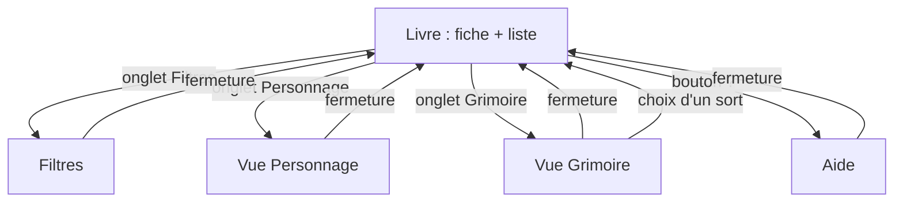
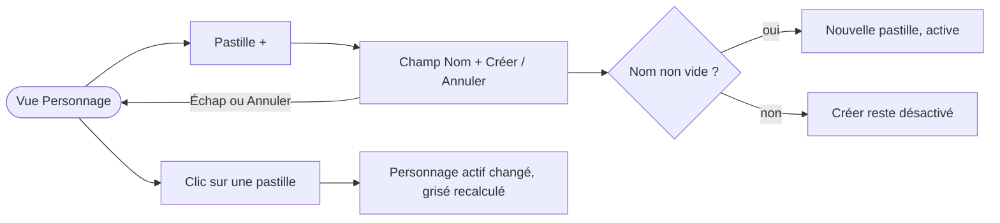
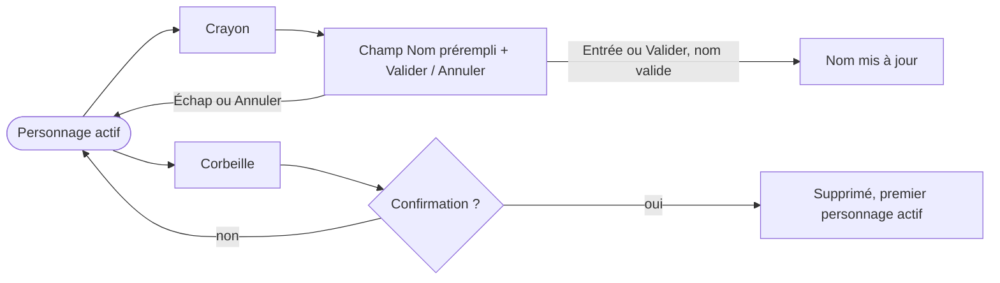
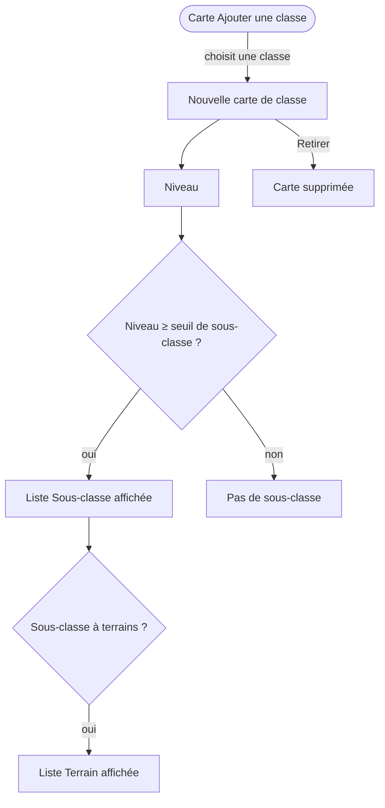
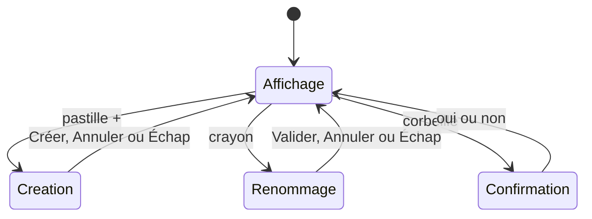
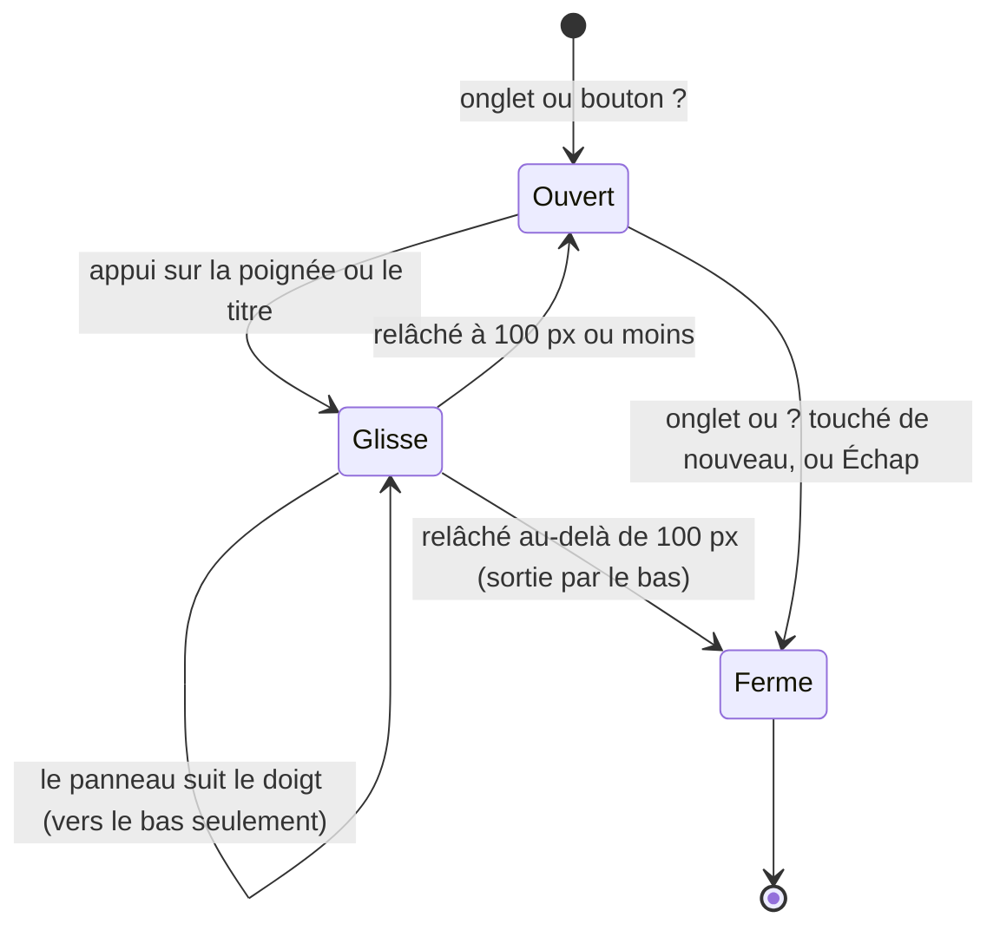

# App flow — Grimoire de sorts, vue Personnage et pagination

Statut : brouillon
Couvre : US-01 … US-05 (définies ci-dessous, pas de PRD pour ce lot)
Design : [DESIGN-BRIEF.md](DESIGN-BRIEF.md). Règles métier existantes : [SPECS.md](SPECS.md).

| ID | User story |
|---|---|
| US-01 | En tant que joueur, je crée un personnage et je le retrouve en un geste. |
| US-02 | En tant que joueur, je renomme ou supprime un personnage sans risque d'erreur. |
| US-03 | En tant que joueur, je donne une ou plusieurs classes à mon personnage, avec niveau et sous-classe, pour griser les sorts hors de sa portée. |
| US-04 | En tant que lecteur, je sais sur quelle page de la liste je suis et combien il en reste. |
| US-05 | En tant qu'utilisateur clavier, j'ouvre, parcours et ferme une vue sans perdre le focus. |

## 1. Carte des écrans et vues

Fermeture d'une vue : son onglet (ou le bouton ?) touché de nouveau, ou Échap. En plus : la croix en desktop, le glisser vers le bas en mobile (§4).

| Écran / vue | Rôle | Accès depuis |
|---|---|---|
| Livre | Fiche (page gauche), liste paginée (page droite) | Arrivée |
| Vue Personnage | Choix, création, renommage, suppression du personnage, gestion de ses classes | Onglet Personnage |
| Vue Filtres, vue Grimoire, Aide | Contenu inchangé dans ce lot. Comportement clavier commun (US-05), présentation mobile en panneau (§4) | Onglets, bouton ? |

## 2. Parcours utilisateur

### Parcours US-01 : créer et choisir un personnage

| Étape | Action utilisateur | Réponse du système | Cas d'erreur |
|---|---|---|---|
| 1 | Clic sur la pastille « + » | La rangée de pastilles reste. Un formulaire `Nom` + `Créer` + `Annuler` apparaît dessous, focus dans le champ. | — |
| 2 | Saisit un nom, Entrée ou `Créer` | `addCharacter(nom)` : la pastille apparaît, sélectionnée (`aria-pressed="true"`). Le formulaire se ferme. Le focus va sur la nouvelle pastille. | Nom vide ou blanc : `Créer` désactivé, Entrée sans effet. Plus de 40 caractères : saisie bloquée (`maxLength`). Nom déjà pris (sans tenir compte des majuscules ni des accents) : `Créer` désactivé, « Ce nom est déjà pris. » |
| 3 | Échap ou `Annuler` | Formulaire fermé, saisie perdue, focus sur la pastille « + ». **La vue reste ouverte.** | — |
| 4 | Clic sur une autre pastille | `setActiveCharacterId(id)` : pastille sélectionnée, nom et classes du personnage affichés. | — |

Doublons de nom : refusés à la création et au renommage (D-08). Les doublons déjà enregistrés restent tels quels.

### Parcours US-02 : renommer, supprimer

| Étape | Action utilisateur | Réponse du système | Cas d'erreur |
|---|---|---|---|
| 1 | Clic sur le crayon | Le nom devient un champ prérempli, texte sélectionné, avec `Valider` et `Annuler`. | — |
| 2 | Entrée ou `Valider` | `renameCharacter` appelé **une seule fois**. Retour à l'affichage du nom, focus sur le crayon. | Nom vide ou pris par un autre personnage : `Valider` désactivé, message si pris. Nom identique : pas d'appel, retour à l'affichage. |
| 3 | Échap ou `Annuler` | Ancien nom conservé, focus sur le crayon. La vue reste ouverte. | — |
| 4 | Clic sur la corbeille | La rangée d'actions devient `Supprimer « Gandalf », ses classes et ses sorts ? [Supprimer] [Annuler]`, focus sur `Annuler` (D-05). | Un seul personnage : corbeille désactivée, et texte visible « Il faut garder au moins un personnage. » sous les boutons. |
| 5 | `Supprimer` | `removeCharacter` : le premier personnage restant devient actif, focus sur sa pastille. | — |
| 6 | `Annuler` ou Échap | Retour à l'affichage, focus sur la corbeille. La vue reste ouverte. | — |

### Parcours US-03 : classes et multiclasse

| Étape | Action utilisateur | Réponse du système | Cas d'erreur |
|---|---|---|---|
| 1 | Choisit une classe dans la carte « Ajouter une classe » | `addProfile` : une carte apparaît au-dessus. La carte d'ajout se vide et reste en dernier. | Liste des classes en échec : message d'erreur dans la vue (existant). |
| 2 | Change de classe dans une carte | Niveau conservé, sous-classe et terrain effacés (règle existante). | — |
| 3 | Choisit un niveau | Texte « Sorts accessibles : jusqu'au niveau N ». Sous le seuil de déblocage : sous-classe effacée (règle existante). | Calcul en cours : « Calcul des sorts accessibles… » (`role="status"`). Échec : message (`role="alert"`). |
| 4 | Option « Niveau non précisé (tous les sorts) » | Texte « Sorts accessibles : tous les niveaux (niveau non précisé) ». | — |
| 5 | `Retirer` sur une carte | `removeProfileById` : carte supprimée, focus sur la carte suivante ou sur la carte d'ajout. Les autres cartes gardent leur état (clé `profile.id`). | — |

Plafond de niveau total (D-04) :

- La section Classes affiche `Niveau total : N / 20`. N = somme des niveaux **précisés**. « Niveau non précisé » ne compte pas.
- Une carte propose les niveaux 1 à `20 − (somme des niveaux précisés des autres cartes)`, plus « Niveau non précisé (tous les sorts) ». Si ce maximum vaut 0, seule l'option « non précisé » reste.
- Une nouvelle classe arrive en « non précisé » (comportement actuel), donc toujours possible.
- Données anciennes au-delà de 20 : total affiché en Caput Mortuum (`25 / 20, réduisez un niveau`). Aucune modification automatique. Le niveau actuel d'une carte reste toujours dans sa liste, même au-delà du maximum.
- Calcul dans une fonction pure testable (`src/utils/`), pas dans le JSX.

### Parcours US-04 : savoir où l'on est dans la liste

| Étape | Action utilisateur | Réponse du système | Cas d'erreur |
|---|---|---|---|
| 1 | Ouvre l'application | `319 / 319 sorts · page 1 / 23` en haut de la page de la liste (23 pages desktop à 14 sorts, 20 pages mobile à 16). | Chargement ou erreur API : ligne absente, message existant. |
| 2 | Tourne la page (coin du livre) | Ligne masquée pendant l'animation, puis `page 2 / 23`. Le lecteur d'écran entend « Page 2 sur 23 ». | — |
| 3 | Filtre, recherche ou bouton œil | Retour page 1 (règle existante), total recalculé : `42 / 319 sorts · page 1 / 3`. | Aucun résultat : `0 / 319 sorts · page 1 / 1`. |
| 4 | Passe de desktop à mobile | Total recalculé. La page courante est ramenée dans les bornes (règle existante). | — |

## 3. États des écrans clés

Les états Création et Renommage s'excluent : en ouvrir un ferme l'autre sans enregistrer. Fermer la vue pendant Création ou Renommage abandonne la saisie.

## 4. Desktop / mobile

| Point du parcours | Desktop | Mobile |
|---|---|---|
| Page | Pas de défilement horizontal | Pas de défilement horizontal, vue ouverte comprise |
| Barre d'outils | Une ligne : œil, recherche, onglets | Une ligne : œil, recherche (place restante), onglets |
| Fiche affichée (page gauche) | Barre d'outils visible | Œil, recherche et onglets masqués (place gardée, le livre ne saute pas) |
| Vues (Filtres, Personnage, Grimoire, Aide) | Feuille posée sur le livre ; l'aide couvre la zone du livre | Panneau sur toute la largeur de l'écran, du dessous des onglets jusqu'au bas de l'écran |
| Fermer une vue | Croix, onglet, Échap | Glisser vers le bas (poignée ou titre), onglet ou bouton ?, Échap. Pas de croix |
| Pastilles | Une ligne, retour à la ligne si besoin | Retour à la ligne, aucun défilement horizontal |
| Cartes de classe | Champs côte à côte | Champs empilés |
| Indicateur de page | Ligne du compteur | Ligne du compteur, sur une ligne dans 250 px |

Panneau mobile, geste de fermeture :

Le contenu du panneau garde son défilement normal : seuls la poignée et le titre déclenchent le glisser.

## 5. Clavier et accessibilité du parcours

- Ouverture d'une vue : focus sur son titre (existant).
- Dans une vue : Tab et Maj+Tab bouclent dans la vue, sans en sortir (US-05). La barre d'outils (bouton œil, recherche) est inerte pendant qu'une vue est ouverte. Les onglets restent cliquables pour passer d'une vue à l'autre.
- Échap :
  - dans un formulaire de création ou de renommage : annule ce formulaire seulement ;
  - ailleurs dans la vue : ferme la vue, focus rendu à l'onglet (existant).
- Mobile : le glisser vers le bas a toujours une alternative en un seul appui (onglet ou bouton ?), et Échap au clavier. La poignée est décorative (`aria-hidden`).
- Pastilles : `<button aria-pressed>` dans un groupe nommé « Personnages ».
- Après choix d'un sort depuis le grimoire en mobile : focus sur le titre de la fiche, pas sur l'onglet masqué (B7, mineur, hors lot sauf avis contraire).

## 6. Questions ouvertes

Aucune. Décisions D-01 à D-08 dans [DESIGN-BRIEF.md](DESIGN-BRIEF.md).
