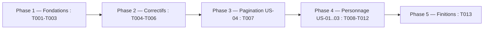
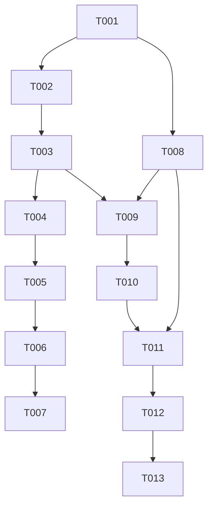

# Plan d'implémentation — finitions feature/css, pagination, vue Personnage

Statut : brouillon
Couvre : US-01 … US-05 ([APP-FLOW.md](APP-FLOW.md)), décisions D-01 … D-08 ([DESIGN-BRIEF.md](DESIGN-BRIEF.md)), constats de revue du 2026-10-15 (B1–B5, A1–A4)
Branche : `feature/css` (exception au `CLAUDE.md` décidée le 2026-10-15, voir §2)

## 0. En bref (ce que l'utilisateur verra changer)

**Ce qui ne change pas** : les données. Le stockage des personnages, de leurs sorts et de leurs classes (`usePersonalSpellbook`) n'est pas touché. Un personnage garde son propre grimoire. Les filtres, le tri, la recherche et la scène 3D restent tels quels.

| Tâches | Nature | Ce qui change à l'écran |
|---|---|---|
| T001 | Rangement | Les captures de test ne polluent plus `git status`. Rien de visible. |
| T002 | Style | Le gris des sorts hors profil est un peu plus foncé (lisible). Le lien du pied de page passe en papier clair souligné. |
| T003 | Style | Dans les vues (Filtres, Personnage), tous les champs ont la même taille et la même bordure. Ils sont plus grands au doigt et ne font plus zoomer l'iPhone. |
| T004 | Style | Toutes les icônes viennent de Lucide : œil, croix, flèches de page, livre de l'onglet. Le bouton de la fiche devient un livre avec « + » / « − » intégré. |
| T005 | Correctif | Bouton grimoire de la fiche : l'infobulle de l'appui long s'affiche enfin (sous le bouton). Le clavier n'est plus bloqué après un appui long. |
| T006 | Correctif | Vue ouverte : Tab reste dans la vue, Échap la ferme toujours. On ne peut plus taper dans la recherche derrière une vue. |
| T007 | Nouveauté | En haut de la liste : `319 / 319 sorts · page 2 / 23`. |
| T008 | Règles (invisible seul) | Deux règles prêtes pour la vue Personnage : niveau total ≤ 20, nom unique. |
| T009-T010 | Vue Personnage (haut) | Les personnages s'affichent en pastilles cliquables au lieu d'une liste déroulante. « + » crée un personnage. Un crayon renomme, une corbeille supprime avec une confirmation dans la vue. Nom limité à 40 caractères, doublons refusés. |
| T011-T012 | Vue Personnage (bas) | Chaque classe devient une carte avec un seul bouton « Retirer » : plus de `×` partout. La ligne `Niveau total : 12 / 20` empêche de dépasser 20 en multiclasse. Une carte en pointillés sert à ajouter une classe. |
| T013 | Petit plus | La vue Grimoire s'appelle « Grimoire de Gandalf (3) ». |

**Nouvelles règles de comportement** (le reste est du style ou des correctifs) :

- niveau total plafonné à 20 en multiclasse ;
- noms de personnage uniques, 40 caractères au plus ;
- confirmation de suppression dans la vue, au lieu de la boîte grise du navigateur.

## 1. Objectif du lot

Corriger les défauts majeurs de la branche (bouton grimoire, clavier dans les vues, contrastes, icônes hors charte), afficher la page courante à côté du compteur, et livrer la nouvelle vue Personnage (pastilles, cartes de classe, plafond de niveau 20, noms uniques). Chaque tâche passe lint, build et un contrôle navigateur avant son commit.

## 2. Décisions préalables

| # | Question | Décision | Raison |
|---|---|---|---|
| 1 | Périmètre | Constats majeurs + évolutions 2 et 3. Mineurs listés, non traités. | Choix utilisateur du 2026-10-15. |
| 2 | Couleurs, icônes, pagination, vue Personnage | D-01 à D-08 | [DESIGN-BRIEF.md §8](DESIGN-BRIEF.md#8-décisions-du-2026-10-15-questions-résolues) |
| 3 | Branche de travail | Rester sur `feature/css`. Fusion dans `dev` à la fin du lot, après accord explicite. | Décision utilisateur du 2026-10-15 : lot surtout visuel, dans la continuité de la branche. Exception assumée au `CLAUDE.md` (pas de `feature/*`). |
| 4 | Tests automatisés | Aucun framework de test dans le projet. Vérification : lint, build, navigateur (`workflow:verifier`). | Pas d'ajout d'outillage dans ce lot. |
| 5 | Commits | Faits par l'orchestrateur seulement, un par tâche, après `pass` du vérificateur. Format du `CLAUDE.md` projet : `type(scope): phrase résumé.` puis une ligne `- …` par ajout. Jamais de `Co-Authored-By`. Ajout explicite des fichiers (pas de `git add -A`). | Le `CLAUDE.md` projet prime sur toute autre consigne d'attribution. |
| 6 | Retours de la revue QA du plan (2026-10-15) | Intégrés dans T001, T003, T004, T006, T008, T010, T011, T012. Non retenus : annonce « Page 1 sur 1 » pendant le chargement (T007, acceptée), élision devant un h aspiré (T013, acceptée), saut direct à une page (hors lot). | Voir chaque fichier de tâche. |

## 3. Phases

Règles :
- Fondations d'abord (dépôt, couleurs, CSS des vues), puis correctifs, puis évolutions.
- Exécution séquentielle : `App.tsx` et `App.css` sont partagés par la plupart des tâches.
- `[P]` = aucun fichier en commun avec les autres tâches de la phase. Non exploité ici (exécution séquentielle), indiqué pour information.

## 4. Tâches

| ID | Tâche | Story / constat | Fichiers cibles | Dépend de | [P] | Statut |
|---|---|---|---|---|---|---|
| T001 | Ignorer les captures de test | hygiène | `.gitignore` | — | | à faire |
| T002 | Ajouter les tokens de couleur et corriger les contrastes | A1, A3, D-01 | `src/index.css`, `src/App.css` | T001 | | à faire |
| T003 | Unifier les champs et boutons des vues | M1 archi, A2, iOS | `src/App.css`, `src/App.mobile.css`, `src/components/FiltersView.tsx`, `src/components/CharacterSelector.css`, `src/components/SpellcasterProfileForm.css` | T002 | | à faire |
| T004 | Passer toutes les icônes à Lucide | D-02, D-06, A4 | `public/icons/*`, `src/App.tsx`, `src/App.css`, `src/components/{Bookmarks,SpellbookToggle,HelpView,PageTurnZone}.tsx`, `src/components/PageTurnZone.css` | T003 | | à faire |
| T005 | Réparer l'infobulle et le clavier du bouton grimoire | B1, B2 | `src/components/SpellbookToggle.tsx`, `src/App.css` | T004 | | à faire |
| T006 | Garder le focus dans les vues ouvertes | B3, US-05 | `src/components/BookmarkView.tsx`, `src/App.tsx`, `src/App.css` | T005 | | à faire |
| T007 | Afficher la page courante à côté du compteur | US-04, D-03 | `src/App.tsx`, `src/components/BookSpread.tsx`, `src/index.css` | T006 | | à faire |
| T008 | Écrire les règles de niveau total et de nom unique | D-04, D-08 | `src/utils/characterLevels.ts`, `src/utils/characterName.ts` (créés) | T001 | [P] | à faire |
| T009 | Créer le formulaire de nom de personnage | US-01, US-02, B4 | `src/components/CharacterNameForm.tsx` (créé) | T003, T008 | | à faire |
| T010 | Refondre le sélecteur de personnage en pastilles | US-01, US-02, D-05 | `src/components/CharacterSelector.tsx`, `src/components/CharacterSelector.css` | T009 | | à faire |
| T011 | Refondre le formulaire de classe en carte | US-03, D-04 | `src/components/SpellcasterProfileForm.tsx`, `src/components/SpellcasterProfileForm.css` | T008, T010 | | à faire |
| T012 | Assembler la vue Personnage (sections, total, clés) | US-03, B5 | `src/components/CharacterView.tsx`, `src/App.css` | T011 | | à faire |
| T013 | Nommer le personnage dans le titre du grimoire | D-07 | `src/components/SpellbookView.tsx`, `src/App.tsx` | T012 | | à faire |

Fichier détaillé de chaque tâche : `docs/tasks/Txxx-slug.md`. Exécutants : `workflow:executor` (T001), `workflow:back` (T008), `workflow:front` (les autres).

## 5. Graphe de dépendances

Ordre d'exécution retenu : T001 → T002 → … → T013, dans l'ordre des numéros (séquentiel, même si T008 pourrait passer plus tôt).

## 6. Vérification du lot

| Contrôle | Commande / méthode | Attendu |
|---|---|---|
| Lint | `npm run lint` | 0 erreur |
| Build | `npm run build` | succès (l'avertissement de taille de chunk > 500 kB existe déjà, toléré) |
| Parcours US-01 à US-05 | [APP-FLOW.md](APP-FLOW.md) §2 et §5, à 1440×900 et 390×844 | conforme |
| Console | navigateur | aucun avertissement React (`key`), hors `THREE.Clock` existant |
| Relecture du lot | `workflow:reviewer` sur `<début>..HEAD` | pas de Bloquant ni Majeur |

## 7. Risques

| Risque | Probabilité | Impact | Parade |
|---|---|---|---|
| Une icône Lucide plus fine (trait 2 sur 24 px) paraît trop légère à 20-22 px | moyenne | faible | Contrôle visuel du vérificateur. Ajuster la taille d'affichage, jamais le SVG. |
| Le piège de focus (T006) bloque un contrôle masqué ou désactivé | faible | moyen | Filtrer les éléments sans boîte (`getClientRects().length === 0`) et désactivés. AC dédiés. |
| La refonte du formulaire de classe casse une règle en cascade (sous-classe effacée au changement de classe ou de niveau) | moyenne | élevé | T011 conserve les blocs `onChange` existants mot pour mot. AC sur chaque cascade. |
| Données anciennes avec niveau total > 20 | faible | faible | Affichage d'alerte, aucune modification automatique (D-04). |
| `curl` vers unpkg indisponible pendant T004 | faible | moyen | Escalade à l'orchestrateur, qui fournit les fichiers. |

## 8. Suivi

Commit de début de lot : à noter au lancement de T001.

| Tâche | Commit | Vérifié le | Remarque |
|---|---|---|---|
