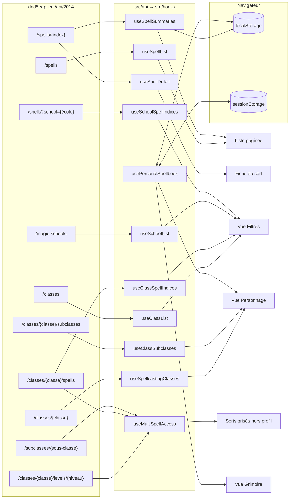
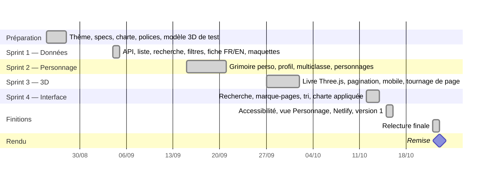

# Documents de préparation

Complète les autres documents demandés par la [consigne](CONSIGNE.md#ce-que-vous-devez-rendre) :

| Document demandé | Où le trouver |
|---|---|
| Wireframe ou maquette | [`Maquettes/`](Maquettes/) : V1 grossière (`Desktop-home.png`, `Mobile-home.png`), V2 (`SpellBookV2.png`, `MobileV2.png`) |
| Arborescence de navigation | [APP-FLOW.md §1](APP-FLOW.md#1-carte-des-écrans-et-vues) |
| Schéma d'intégration des données | [§1 ci-dessous](#1-schéma-dintégration-des-données) |
| Planning | [§2 ci-dessous](#2-planning-réalisé) |
| Spécifications et charte | [SPECS.md](SPECS.md), [DESIGN.md](DESIGN.md) |

## 1. Schéma d'intégration des données

Source unique : l'[API D&D 5e](https://www.dnd5eapi.co/) (`https://www.dnd5eapi.co/api/2014`), REST, sans authentification. Aucune copie locale des données n'a été nécessaire : l'API accepte les requêtes du navigateur (CORS).



| Donnée | Endpoint | Fonction (`src/api/`) | Hook (`src/hooks/`) | Usage |
|---|---|---|---|---|
| Liste des 319 sorts | `/spells?lang=en` + `?lang=fr-FR` | `fetchSpellList` | `useSpellList` | Liste, recherche FR/EN, tri |
| Détail d'un sort | `/spells/{index}?lang=en` + `?lang=fr-FR` | `fetchSpellDetail` | `useSpellDetail` | Fiche (page gauche) |
| Résumé d'un sort | idem détail | `fetchSpellSummary` | `useSpellSummaries` | Dégâts, JS, portée, forme dans la liste ; 4 requêtes en parallèle au plus, cache `localStorage` |
| Classes | `/classes?lang=…` | `fetchClassList` | `useClassList` | Filtre par classe |
| Sorts d'une classe | `/classes/{classe}/spells` | `fetchClassSpellIndices` | `useClassSpellIndices`, `useMultiSpellAccess` | Filtre par classe, accès du personnage |
| Écoles de magie | `/magic-schools?lang=…` | `fetchSchoolList` | `useSchoolList` | Filtre par école |
| Sorts d'une école | `/spells?school={école}` | `fetchSchoolSpellIndices` | `useSchoolSpellIndices` | Filtre par école |
| Classes lanceuses de sorts | `/classes/{classe}?lang=en` | `fetchSpellcastingClassIndices` | `useSpellcastingClasses` | Liste des classes de la vue Personnage |
| Emplacements de sorts | `/classes/{classe}/levels/{niveau}?lang=en` | `fetchClassLevelSpellcasting` | `useMultiSpellAccess` | Niveau de sort max du personnage |
| Sous-classes | `/classes/{classe}/subclasses?lang=…` | `fetchClassSubclasses` | `useClassSubclasses` | Liste des sous-classes |
| Sorts d'une sous-classe | `/subclasses/{sous-classe}?lang=…` | `fetchSubclassSpells` | `useMultiSpellAccess` | Sorts accordés d'office |

Règles communes :

- Langue toujours explicite (`?lang=en` ou `?lang=fr-FR`). Sans paramètre, l'API répond selon l'en-tête `Accept-Language` du navigateur (détail : [SPECS.md](SPECS.md#localisation-française)).
- Mise en cache en mémoire par clé (`useKeyedFetch`, `useMultiKeyedFetch`) : un hook ne redemande jamais une ressource déjà chargée. Une clé en échec n'est pas retentée avant le rechargement de la page.
- Le modèle 3D (`public/assets/spellbook_lowpoly_v2.glb`) est un fichier statique du site, chargé par `useGLTF` dans `BookCanvas`. Il ne dépend pas de l'API.

### Stockage local

| Clé | Stockage | Contenu |
|---|---|---|
| `dnd-personal-spellbook` | `localStorage` | Personnages, leurs sorts et leurs classes (format v4 ci-dessous). Synchronisé entre onglets par l'événement `storage`. |
| `dnd-personal-spellbook:active-tab` | `sessionStorage` | Personnage actif, propre à chaque onglet : deux onglets peuvent afficher deux personnages différents. |
| `dnd-spell-book:spell-summaries:v2` | `localStorage` | Cache des résumés de sorts de la liste, rempli progressivement. |

Format v4 du grimoire (les formats v0 à v3 sont relus et migrés en un personnage « Personnage 1 ») :

```json
{
  "version": 4,
  "activeCharacterId": "…",
  "characters": [
    {
      "id": "…",
      "name": "Personnage 1",
      "spells": [{ "index": "fireball", "addedAt": "2026-10-15T08:00:00.000Z" }],
      "profiles": [
        { "id": "…", "classIndex": "wizard", "characterLevel": 5, "subclassIndex": "evocation", "subclassFeatureIndex": null }
      ]
    }
  ]
}
```

Aucune donnée n'est envoyée à un serveur. Effacer les données du site dans le navigateur supprime les personnages.

## 2. Planning réalisé

Planning reconstitué après coup à partir des dates des commits git (`git log --date=short`), et non planning prévisionnel. Il couvre la période fixée par la consigne : préparation le 25/08, réalisation jusqu'au 23/10.



| Dates | Phase | Livré |
|---|---|---|
| 25/08 – 28/08 | Préparation | Projet React + Vite + TypeScript. Thème, spécifications et décisions produit. Charte graphique (palette, polices, icônes Lucide). Premier modèle 3D de test. |
| 04/09 | Sprint 1 — données | Connexion à l'API. Liste brute, recherche par nom (sans accents), filtres par niveau, classe et école. Fiche complète avec bascule FR / EN / FR+EN. Maquettes Figma V1. |
| 15/09 – 21/09 | Sprint 2 — personnage | Grimoire personnel en `localStorage`, synchronisé entre onglets. Profil de lanceur de sorts, sorts grisés hors profil, sous-classes, multiclasse, plusieurs personnages. Revue de code et corrections. Liste enrichie (dégâts, JS, portée, forme). Maquettes V2. |
| 27/09 – 02/10 | Sprint 3 — rendu 3D | Livre Three.js (react-three-fiber) avec les pages HTML superposées. Pagination. Mobile : une moitié du livre à la fois, glissement entre les pages. Animation de tournage de page. |
| 12/10 – 14/10 | Sprint 4 — interface | Recherche toujours visible, marque-pages et vues, tri. Interface dans la langue du navigateur. Charte appliquée (textures, polices). Header, footer et aide. |
| 15/10 – 16/10 | Finitions | Contrastes AA, icônes 100 % Lucide, focus clavier dans les vues. Nouvelle vue Personnage (pastilles, cartes de classe, niveau total ≤ 20). Indicateur de page. Vues mobiles en panneau. Publication Netlify, version 1. |
| 22/10 | Relecture finale | Mise à l'échelle desktop sur toutes les largeurs. Libellés français. Nettoyage du code et des documents. |
| 23/10 | Rendu | Envoi des liens GitHub et Netlify. |
